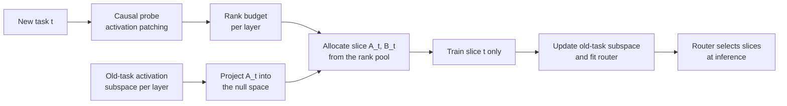

# Causal-Orthogonal LoRA

**Continual learning for small language models on a single consumer GPU, without overwriting prior knowledge.**

Small language models (SLMs) forget earlier skills when fine-tuned sequentially, for example math followed by code.
This project addresses that with a memory-efficient adapter design: a pre-allocated pool of LoRA ranks in which every
task receives its own slice, sized by causal importance, constrained to be orthogonal to earlier tasks, and selected at
inference by a lightweight router that needs no task ID.

> Status: research code. The core components are unit tested on CPU. Benchmark results are produced by the scripts
> below and are not bundled; see [Results](#results).

---

## Contents

- [Method](#method)
- [Repository structure](#repository-structure)
- [Installation](#installation)
- [Quickstart](#quickstart)
- [Experiments and ablations](#experiments-and-ablations)
- [Task stream and metrics](#task-stream-and-metrics)
- [Results](#results)
- [Hardware notes](#hardware-notes)
- [Limitations](#limitations)
- [Testing](#testing)
- [Related work](#related-work)
- [Citation](#citation)
- [License](#license)

---

## Method

Every targeted linear layer owns a pool of `capacity` LoRA ranks (default 64). As each task arrives it claims a slice
of that pool. Three mechanisms govern the claim.



### 1. Causal rank budgeting

Before training on task *t*, a short probe (about 200 examples) measures how much each layer matters for the task.
The probe replaces a layer's module outputs with their mean (an intervention, or activation patching) and records the
increase in loss. Ranks are then allocated in proportion to this indirect effect, so causally important layers receive
more capacity and irrelevant layers receive almost none.

- `budget: causal` mean-ablation activation patching (headline method)
- `budget: gradient` attribution patching, a first-order approximation using one backward pass (cheap proxy)
- `budget: uniform` equal ranks everywhere (ablation baseline)
- Optional causal conflict detection: layers where the new task's causal profile overlaps with earlier tasks receive
  extra rank (`probe.conflict_lambda`).

### 2. Activation null-space orthogonality

Orthogonality between LoRA parameter matrices does not by itself prevent interference, because what matters is how an
update acts on the input activations of earlier tasks. This project estimates the input-activation subspace of old
tasks per layer (SVD with an energy threshold, in the style of gradient projection memory) and constrains each new
`A` matrix to the orthogonal complement of that subspace:

```
A_eff = A - (A U) U^T        so that        A_eff x_old ~ 0
```

The projection is part of the forward pass, so it holds under any optimizer, including Adam. After training it is
baked into the weights. A parameter-space penalty in the style of O-LoRA is provided for comparison
(`orth: parameter`).

A layer-local diagnostic, `leakage_terms`, upper-bounds the relative change a new slice can cause on stored old-task
activations. It is intended to be compared against measured forgetting; it is not an end-to-end guarantee.

### 3. Task-ID-free routing

A router maps each prompt to slice weights using the mean-pooled mid-depth hidden state of the prompt, computed with all
adapters disabled so features never drift as adapters are trained.

- `router.type: prototype` class means with a shared shrunk covariance and Mahalanobis distance. Nothing is trained
  and no raw data is stored.
- `router.type: gate` a small linear gate trained on a few stored feature vectors per task (a mild form of feature
  replay).
- Routers are fitted on original and perturbed prompts (casing, template, whitespace) so that routing does not depend
  on surface cues.
- `router.top_k` controls hard (1) or blended (k > 1) routing.

---

## Repository structure

```
causal-orth-lora/
├── configs/
│   ├── ours.yaml            # full method
│   ├── seq_lora.yaml        # baseline: one LoRA reused for every task
│   └── oracle_lora.yaml     # reference: one LoRA per task, oracle task IDs
├── src/
│   ├── lora_pool.py         # rank pool, routing context, rank allocation
│   ├── orthogonal.py        # null-space estimation, parameter penalty, leakage bound
│   ├── causal_probe.py      # activation patching, attribution patching, conflict detection
│   ├── router.py            # feature extractor, prototype router, learned gate
│   ├── data.py              # task loaders, tokenization, prompt perturbations
│   ├── train_stream.py      # continual-learning loop (entry point)
│   ├── utils.py
│   └── eval/
│       ├── evaluate.py      # generation and multiple-choice evaluation
│       ├── metrics.py       # ACC, BWT, forgetting, forward transfer
│       └── code_exec.py     # subprocess runner for MBPP unit tests
├── scripts/
│   ├── run_all.sh           # baselines, ablations, plots
│   └── make_plots.py        # accuracy matrices, forgetting curves, summary table
├── tests/                   # CPU unit tests and a toy end-to-end test
├── requirements.txt
└── README.md
```

---

## Installation

```bash
git clone https://github.com/<your-username>/causal-orth-lora.git
cd causal-orth-lora
python -m venv .venv && source .venv/bin/activate
pip install -r requirements.txt
```

A CUDA GPU is required to run experiments with a 4-bit base model (bitsandbytes). The unit tests run on CPU.

---

## Quickstart

Run the full method on the default stream (GSM8K, MBPP, ARC-Challenge, SST-2) with Qwen2.5-1.5B:

```bash
python -m src.train_stream --config configs/ours.yaml
```

Run a short smoke test first to check your environment:

```bash
python -m src.train_stream --config configs/ours.yaml \
  --set tasks=[gsm8k,sst2] data.n_train=200 data.n_eval=50 out_dir=runs/smoke
```

Any config value can be overridden with `--set key=value` using dotted paths. Outputs are written to
`runs/<name>/`:

- `results.json` accuracy matrix, CL metrics, router accuracy, per-task ranks, parameters, training time, peak VRAM
- `adapters.pt` trained adapter slices and router state

Reproduce all baselines, ablations and figures:

```bash
bash scripts/run_all.sh
```

---

## Experiments and ablations

Every baseline and ablation is a configuration change; no code edits are needed.

| Axis | Key | Values |
|---|---|---|
| Adapter layout | `lora.adapter_mode` | `separate` (one slice per task), `shared` (one reused slice, sequential-LoRA baseline) |
| Rank budgeting | `budget` | `uniform`, `causal`, `gradient` |
| Orthogonality | `orth` | `none`, `parameter`, `activation` |
| Router | `router.type` | `prototype`, `gate` |
| Inference policy | `eval.routing` | `router`, `oracle`, `cumulative` (sum all slices) |
| Replay (baseline) | `train.replay_ratio` | fraction of replayed old examples, shared mode only |
| Pool size | `lora.capacity`, `lora.avg_rank` | integers |

Example ablations:

```bash
python -m src.train_stream --config configs/ours.yaml --set budget=uniform out_dir=runs/abl_uniform
python -m src.train_stream --config configs/ours.yaml --set orth=none out_dir=runs/abl_no_orth
python -m src.train_stream --config configs/ours.yaml --set router.type=gate out_dir=runs/abl_gate
```

Training mode follows the inference policy by default (`train.active: auto`): slices are trained in isolation when
inference routes to individual slices, and with earlier slices active when inference sums them. This avoids a mismatch
between training and inference.

---

## Task stream and metrics

Supported tasks: `gsm8k` (math), `mbpp` (code), `arc_challenge`, `arc_easy`, `sciq` (science QA), `sst2` (sentiment),
`ag_news` (topic classification). Generation tasks are scored by numeric match (GSM8K) or by executing unit tests
(MBPP). Classification and multiple-choice tasks compare next-token logits over the candidate answers.

Metrics are computed from the accuracy matrix `R[i][j]`, the accuracy on task `j` after training on task `i`:

| Metric | Definition |
|---|---|
| Average accuracy | mean of the final row of `R` |
| Backward transfer (BWT) | mean of `R[T-1][j] - R[j][j]` over earlier tasks |
| Forgetting | mean of the best earlier accuracy on task `j` minus its final accuracy |
| Forward transfer | accuracy on a task before training on it, minus the untouched base model (`eval.eval_future: true`) |
| Router accuracy | fraction of prompts routed to their true task |
| Cost | peak VRAM, trainable parameters per task, training time per task |

Run each configuration with multiple seeds and at least two task orderings, and report confidence intervals.

---

## Results

Results are not bundled with this repository. After running the experiments, fill in the table below from
`runs/*/results.json` (`scripts/make_plots.py` writes `figures/summary.md` with the same columns).

| Method | Avg. accuracy | Forgetting | BWT | Peak VRAM (MB) | Params / task |
|---|---|---|---|---|---|
| Sequential LoRA | TBD | TBD | TBD | TBD | TBD |
| Separate LoRA, oracle routing | TBD | TBD | TBD | TBD | TBD |
| Ours (causal + activation null-space + router) | TBD | TBD | TBD | TBD | TBD |

Figures generated by `scripts/make_plots.py`:

```bash
python scripts/make_plots.py runs/seq_lora runs/oracle_lora runs/ours --out figures
```

- `figures/acc_matrices.png` accuracy matrix per run
- `figures/forgetting_curve.png` accuracy on the first task as the stream progresses
- `figures/summary.md` comparison table

---

## Hardware notes

- The base model is loaded in 4-bit NF4 with bf16 compute; adapters are kept in fp32 and are small relative to the
  base weights. Gradient checkpointing is on by default.
- On GPUs without native bf16 (for example the Colab T4), set `model.dtype: float16`.
- To fit smaller GPUs, reduce `model.max_len`, `train.bs` (and raise `train.grad_accum`), `eval.bs`, or
  `orth_cfg.n_tokens`.
- Measure and report peak VRAM from `results.json` for your own hardware rather than relying on estimates.

---

## Limitations

- The rank pool has finite capacity. As tasks accumulate, free rank and free null-space dimensions shrink. Report how
  performance degrades over a longer stream.
- Null-space bases are estimated from sampled tokens with an energy threshold, so inputs outside the sample can still
  interact slightly with new slices. Use the leakage diagnostic (`orth_cfg.keep_activations: true`) to quantify this.
- Causal probing adds one-time cost per task. Compare against the attribution-patching proxy (`budget: gradient`).
- MBPP evaluation executes generated code in a subprocess with timeouts and resource limits. This is not a security
  sandbox; run it in a container or a disposable environment.
- The learned-gate router stores a small number of feature vectors per task. The prototype router stores only means
  and one covariance matrix.

---

## Testing

```bash
pytest -q
```

The tests run on CPU and cover rank allocation, routing modes, null-space projection (including under Adam), the
leakage diagnostic, router accuracy on synthetic tasks, causal-probe helpers, metrics, and a toy end-to-end run of the
probe, training and null-space steps.

---

## Related work

This project builds on ideas from, and should be compared against:

- LoRA and QLoRA (low-rank and quantized adaptation)
- O-LoRA (orthogonal subspace learning for continual learning)
- InfLoRA (interference-free low-rank adaptation)
- Gradient Projection Memory (null-space continual learning)
- AdaLoRA (importance-based rank allocation)
- LoRAMoE, SAPT and related routed or mixture-of-LoRA methods
- Activation patching and causal mediation analysis for model interpretability

---

